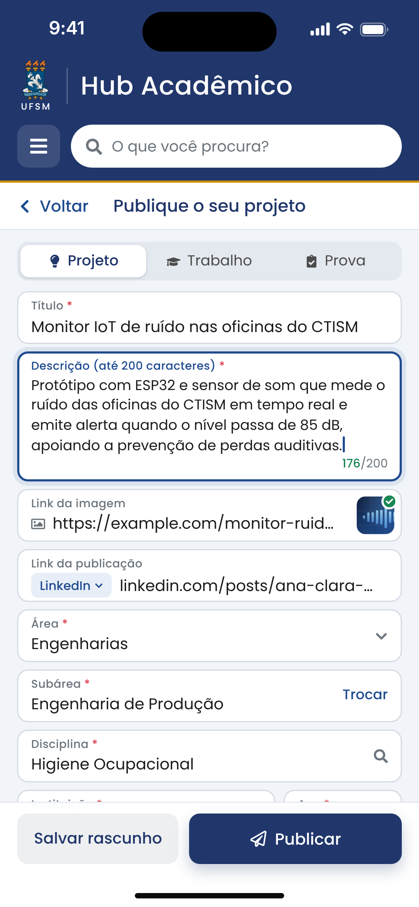
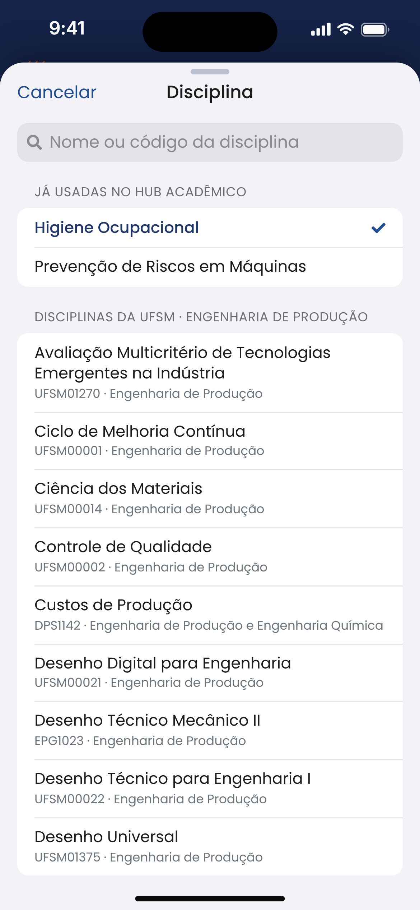

# Hub Acadêmico — CTISM/UFSM

Aplicativo iOS em **SwiftUI** para os(as) estudantes do Colégio Técnico Industrial de Santa Maria (CTISM/UFSM) publicarem e encontrarem **projetos**, **trabalhos acadêmicos**, **provas** (banco de provas) e **material complementar**.

Desenvolvido no **HackaTruck MakerSpace** (Instituto de Pesquisas Eldorado), Deploy 26.1. O visual segue o design system do site da UFSM.

<p align="center">
  
  
  
  
</p>

> Prancha completa com o design system: [`docs/visao-geral-design-system.png`](docs/visao-geral-design-system.png)

---

## Funcionalidades

O app tem **3 telas de navegação e 1 sheet**, ou seja, **4 views programadas**: a Tela 3 (visualização) não é uma página nova, ela sobe como *sheet* por cima da busca.

| Tela | O que faz |
|---|---|
| **1. Início** | Cinco atalhos em **ordem crescente de caracteres**: Projetos → Banco de provas → Trabalhos acadêmicos → Material complementar → **Publique o seu projeto** (em destaque). Os quatro primeiros abrem a Busca já filtrada por aquele tipo. Mostra o primeiro nome do usuário na saudação. |
| **2. Busca** | Campo de busca no cabeçalho, sem diferenciar acentos nem maiúsculas (também procura na área, subárea e disciplina). O **funil** abre os filtros em checkbox, também em ordem crescente de caracteres: Ano, Área, Autor, Curso, Título, Disciplina e Melhor avaliação. O selo dourado mostra quantos filtros estão ativos. Quando aberta por um atalho, mostra só aquele tipo (o selo com ✕ volta para todos). |
| **3. Visualização (sheet)** | Sobe por cima da busca ocupando **80% da altura** e pode ser arrastada até a tela cheia ou para baixo para fechar. Mostra título, imagem carregada do link informado, autoria com o link da publicação original, descrição, **média das avaliações, com estrelas para o(a) estudante dar a sua nota**, área, subárea e disciplina. Também permite compartilhar. |
| **4. Publicar** | Um só formulário para Projeto, Trabalho ou Prova (“Publique o seu projeto”, “… o seu trabalho”, “… a sua prova”): Título, Descrição (contador de **200 caracteres**), Link da imagem (com prévia), Link da publicação (reconhece LinkedIn, Instagram, YouTube, GitHub e blogs), **Área → Subárea → Disciplina em cascata** (veja abaixo), Instituição e Ano. Valida os campos e salva rascunho; ao tocar em **Publicar**, volta para a tela anterior e abre a nova publicação na sheet. A autoria vem do cartão **“Publicando como…”**, que abre **Meu perfil** (nome e curso). |

### Navegação

- **‹ Voltar** (seta com o texto “Voltar”), à esquerda da barra das telas internas, volta **uma tela**. O gesto de arrastar da borda esquerda continua funcionando.
- **☰** no cabeçalho volta **direto para a tela inicial**, de qualquer ponto do app (fecha também a sheet, se estiver aberta). O menu que existia nele foi retirado.

### Publicar em cascata: área → subárea → disciplina

<p align="center">
  
  
</p>

1. **Área:** as 8 grandes áreas da tabela do CNPq.
2. **Subárea:** ao escolher a área, as subáreas dela **abrem logo abaixo, dentro do próprio campo Subárea** (104 no total; as da mesma família, como “Agronomia/…” e “Medicina/…”, ficam agrupadas). Escolhida a subárea, a lista fecha e mostra só a escolhida, com **Trocar** para abrir de novo.
3. **Disciplina:** abre a lista das disciplinas **daquela subárea**, tiradas dos currículos de 140 cursos de graduação da UFSM (7.077 disciplinas), com busca por nome ou código. Também mostra as disciplinas já usadas no Hub naquela subárea. Na busca aparecem ainda as de **outras subáreas** (escolher uma delas ajusta a área e a subárea) e a opção **Usar “texto digitado”**, para disciplinas que não estão na lista, como as dos cursos técnicos do CTISM.

Trocar a área limpa a subárea e a disciplina; trocar a subárea limpa a disciplina. A API do Node-RED confere se a subárea pertence à área.

**Como as disciplinas foram ligadas às subáreas:** pelo **assunto** de cada disciplina (nome e departamento). Ex.: *Genética Molecular e de Microrganismos* → Genética, mesmo sendo dada nos cursos de Agronomia e de Medicina Veterinária. As disciplinas sem assunto próprio (TCC, estágio, tópicos especiais) ficam na subárea do curso. A classificação completa, para conferência, está em [`docs/disciplinas-por-subarea.csv`](docs/disciplinas-por-subarea.csv) (abre no Excel). Duas subáreas não têm disciplina correspondente nos currículos da UFSM: *Educação/Orientação e Aconselhamento* e *Engenharia Naval e Oceânica*; nelas, a disciplina é digitada.

O app funciona **sozinho no aparelho** (modo demonstração) ou **ligado ao Node-RED**, que guarda no **Cloudant** as publicações, os usuários e as avaliações de toda a turma. Veja [Banco de dados: Node-RED e Cloudant](#banco-de-dados-node-red-e-cloudant).

O app já vem com **12 publicações fictícias** de exemplo e com os **17 cursos oficiais do CTISM**.

---

## Requisitos

- Mac com **Xcode 16 ou mais recente**
- **iOS 17** ou mais recente (Simulador ou iPhone)
- Nenhuma dependência externa: só SwiftUI, Observation e CoreText
- Opcional, para compartilhar os dados entre os aparelhos: **Node-RED** com os nós `node-red-contrib-cloudantplus` e um banco **Cloudant** (IBM Cloud)

## Como rodar

1. Abra `HubAcademico.xcodeproj` no Xcode.
2. Escolha um simulador de iPhone (ex.: iPhone 16) e pressione **⌘R**.
3. Para rodar no seu iPhone, escolha seu time em *Signing & Capabilities → Team*. Se o identificador `br.ufsm.ctism.hubacademico` já estiver em uso na sua conta, troque por outro (ex.: `br.ufsm.ctism.hubacademico.seunome`).

> O projeto usa **pastas sincronizadas** do Xcode 16: qualquer arquivo colocado dentro de `HubAcademico/` (código, imagens, fontes, JSON) entra no app automaticamente, sem precisar arrastar nada para o projeto.

**Se o Xcode não abrir o projeto:** crie um projeto novo (*iOS → App*, Interface **SwiftUI**, nome `HubAcademico`). Depois apague os arquivos gerados `ContentView.swift`, `HubAcademicoApp.swift` e `Assets.xcassets` e arraste para dentro dele a pasta `HubAcademico/` deste repositório. Em *Build Settings*, aponte *Info.plist File* para `Config/HubAcademico-Info.plist`.

### Ligar ao servidor Node-RED

O link do servidor fica nos **Ajustes do iPhone**, fora do app (o ☰ agora só volta ao Início):

- **Ajustes › Apps › Hub Acadêmico › Link do servidor** (no iOS 17: **Ajustes › Hub Acadêmico**).
- Ex.: `localhost:1880` no simulador, `192.168.0.10:1880` no iPhone (IP do Mac do laboratório) ou `https://seu-node-red`.
- Campo em branco: o app usa só os dados guardados no aparelho. A mudança vale quando você volta ao app.

Para a turma toda já abrir ligada ao servidor, preencha `HubServidorLink` em `Config/HubAcademico-Info.plist` antes de compilar: na primeira abertura, o link é copiado para os Ajustes, onde pode ser trocado. Se o link digitado nos Ajustes for inválido, a busca mostra um aviso e o app continua com os dados do aparelho.

> Em alguns simuladores recentes, a página do app pode não aparecer nos Ajustes. Nesse caso, use o `HubServidorLink` do Info.plist.

---

## Estrutura

```
HubAcademico/
├── App/                 Entrada do app, estrutura raiz, navegação e sheet da Tela 3 (Router)
├── DesignSystem/        Cores, tipografia, componentes, barra "‹ Voltar" e cabeçalho institucional
├── Modelos/             Publicacao, tipos, áreas e subáreas (CatalogoAreas), cursos do CTISM, formulário e exemplos
├── Recursos/            disciplinas-ufsm.json: disciplinas dos currículos da UFSM por subárea
├── Servicos/            Armazenamento, cliente da API, catálogo de disciplinas, busca por palavras, rascunho e servidor
├── Telas/               Início, Busca, Filtros, Visualização (sheet), Publicar, Subáreas, Disciplinas e Meu perfil
├── Utilitarios/         Extensões (texto, link, média), migração dos nomes antigos e o gesto de voltar
├── Settings.bundle      Campo "Link do servidor" nos Ajustes do iPhone
└── Assets.xcassets      Ícone do app, brasão, cor de destaque e imagens das publicações de exemplo
Config/HubAcademico-Info.plist   Link padrão do servidor e permissões de rede (ATS e rede local)
backend/node-red/                Fluxo do Node-RED (API + Cloudant), código das funções, testes e manual
ferramentas/catalogo/            Gerador do catálogo de áreas, subáreas e disciplinas (Python) e os dados de origem
docs/                            Imagens do design, diagrama do banco e a planilha de disciplinas por subárea
```

### Arquitetura em poucas linhas

- **Estado compartilhado** com `@Observable` (iOS 17): `PublicacaoStore` guarda as publicações e as avaliações; `BuscaModel` guarda o texto e os filtros; `Router` guarda o caminho da navegação e a sheet. Os três são injetados com `.environment(...)`.
- **Cabeçalho institucional** fixo (brasão, nome, ☰ e busca), fora da `NavigationStack`, como no site. As telas internas usam a barra branca com título e **‹ Voltar** (`barraDePagina` em `Tema.swift`).
- **Navegação:** a pilha (`Router.caminho`) só tem Busca e Publicar. “Voltar” usa o `dismiss` da tela; o ☰ chama `Router.voltarAoInicio()`, que esvazia a pilha e fecha a sheet. A Tela 3 é uma `.sheet(item:)` controlada por `Router.visualizacao`, com `presentationDetents([.fraction(0.8), .large])`.
- **Cascata da tela Publicar:** `FormularioPublicacao.escolherArea/escolherSubarea/escolherDisciplina` mantêm área, subárea e disciplina coerentes. As subáreas vêm de `CatalogoAreas.swift`; as disciplinas, de `CatalogoDisciplinas` (lido de `disciplinas-ufsm.json` em segundo plano ao abrir a tela Publicar).
- **Dois modos de dados, mesmas telas:** sem servidor, `PublicacaoStore` grava tudo em `Documents/hub-dados.json`. Com o Node-RED configurado nos Ajustes, ele busca e envia pelo `APIClient` (publicar, avaliar, cadastrar o usuário; o Node-RED grava no Cloudant) e guarda uma cópia local para abrir sem conexão. A lista é atualizada ao abrir o app, ao voltar para ele e ao puxar a busca para baixo. O rascunho da publicação fica sempre no aparelho.
- **Nomes antigos:** na abertura, `MigracaoDeNomes` converte o que versões anteriores gravaram no aparelho (publicações, rascunho, nome e curso, link do servidor). Ninguém perde dados ao atualizar o app.

### Nomes padronizados

Cada coisa tem um nome só, no app, na API, no banco e no código. Ao criar telas ou rotas novas, use estes:

| Use | No código / na API | Não use |
|---|---|---|
| **Publicação** (o item publicado) | `Publicacao`, coleção `publicacao`, `GETpublicacoes`, `POSTpublicacao` | produção, projeto (projeto é só um dos tipos: Projeto, Trabalho, Prova, Material) |
| **Disciplina** | `disciplina`, `GETdisciplinas` | matéria, cadeira |
| **Usuário** | `usuarioId`, coleção `usuario`, cabeçalho `X-Hub-Usuario` | perfil, user (a tela continua se chamando **Meu perfil**) |
| **Publicar** (ação, botão e tela) | `PublicarView`, `FormularioPublicacao` | cadastrar, cadastro (cadastrar fica só para o usuário: `POST /POSTusuario`) |
| **Descrição** | `descricao` | resumo |
| **Média** e **total de avaliações** | `media`, `totalAvaliacoes`; `nota` é só o voto de 1 a 5 | nota média, quantidade; na tela, sempre **Melhor avaliação** |
| **Imagem** | `imagemLink`, `ImagemView`, assets `imagem-…` | capa |
| **Link** (da publicação, da imagem, do servidor) | `link`, `imagemLink`, `servidorLink` | endereço, URL |
| **Visualização** (Tela 3) | `VisualizacaoView`, `Router.visualizacao` | detalhe |
| **Moderação** | cabeçalho `X-Hub-Moderacao`, variável `HUB_MODERACAO_TOKEN` | admin |

### Atualizar o catálogo de áreas e disciplinas

Os arquivos `CatalogoAreas.swift`, `disciplinas-ufsm.json`, `docs/disciplinas-por-subarea.csv` e a lista de subáreas da API são **gerados**. Para mudar a classificação de uma disciplina (ou usar uma planilha mais nova da UFSM), edite as regras ou os dados em `ferramentas/catalogo/` e rode, na raiz do repositório:

```bash
python3 ferramentas/catalogo/gerar_catalogo.py
```

O script usa só a biblioteca padrão do Python 3 e, com o Node.js instalado, também atualiza o fluxo do Node-RED.

---

## Banco de dados: Node-RED e Cloudant

A pasta [`backend/node-red`](backend/node-red) tem o fluxo pronto para importar, no mesmo formato do fluxo da equipe: cada rota é **http in → function → cloudantplus → http response**, com nomes no padrão **GET/POST/UPDATE/DELETE + nome** (`GETpublicacoes`, `POSTpublicacao`, `POSTavaliacao`, `POSTusuario`…). Os dados ficam no banco **`hub-academico-10` do Cloudant**, o mesmo do fluxo da equipe. Em poucas palavras:

1. No Node-RED, confira se a paleta tem os nós **cloudantplus** (☰ › Manage palette › `node-red-contrib-cloudantplus`).
2. Use ☰ › **Import** › `backend/node-red/hub-academico-flows.json` e clique em **Deploy**.
3. Se os nós do Cloudant ficarem com um triângulo vermelho, este Node-RED ainda não tem a configuração da equipe: importe também `backend/node-red/cloudant-config.json`, abra o nó de configuração do Cloudant, cole a **API key** e faça Deploy de novo.
4. Na aba de depuração (🐞) deve aparecer *“Cloudant conectado…”*. Com o banco vazio, as 12 publicações de exemplo são criadas sozinhas.
5. No iPhone ou simulador: **Ajustes › Apps › Hub Acadêmico › Link do servidor** › `localhost:1880` (simulador) ou `IP-DO-MAC:1880` (iPhone). Volte ao app.

**Já usava a versão anterior?** Ela respondia em `/hub/...` e guardava os dados no contexto do Node-RED. Atualize o app e o fluxo juntos, e apague a aba antiga. As publicações gravadas na versão anterior não passam sozinhas para o Cloudant.

O passo a passo completo, os documentos do banco, as rotas com exemplos em `curl`, a moderação e os testes estão em [`backend/node-red/README.md`](backend/node-red/README.md).

---

## Design system (extraído de ufsm.br)

| Token | Valor | Uso |
|---|---|---|
| Azul UFSM | `#21376B` | cabeçalho, títulos, botão primário (`--bs-primary` do site) |
| Azul secundário | `#204C90` | ícones e rótulos, como na faixa "Utilidades" do site do CTISM |
| Azul profundo | `#142140` | fundos de destaque |
| Dourado | `#CC8F00` | filete do cabeçalho, marcadores de seção |
| Âmbar | `#FFC107` | estrelas de avaliação |
| Texto | `#1C1C1C` / `#4C4C4C` / `#6C757D` | níveis 1, 2 e 3 |
| Fundo e bordas | `#F1F4F9` / `#D3D7E1` | telas e campos |
| Fonte | **Rawline** (400, 500, 600, 700) | fonte oficial do tema da UFSM |
| Raios | 10 / 14 / 16 pt | campos e botões / cartões / menu |

| Ícone no site (Font Awesome 5) | SF Symbol usado no app |
|---|---|
| `lightbulb` (Projetos) | `lightbulb.fill` |
| `clipboard-check` (Banco de provas) | `checklist` |
| `graduation-cap` (Trabalhos acadêmicos) | `graduationcap.fill` |
| `book-open` (Material complementar) | `book.fill` |
| `plus-circle` (Publique o seu projeto) | `plus.circle.fill` |
| `filter` / `search` / `bars` (voltar ao Início) | `line.3.horizontal.decrease` / `magnifyingglass` / `line.3.horizontal` |
| `chevron-left` + “Voltar” | `chevron.backward` + “Voltar” |
| `star` (avaliação) | `star.fill` |

### Usar a fonte Rawline (recomendado)

Sem a Rawline, o app usa a fonte do sistema e o layout continua igual. Para ficar idêntico ao site:

```bash
pip install fonttools brotli
mkdir -p HubAcademico/Recursos/Fontes && cd HubAcademico/Recursos/Fontes
for p in 400 500 600 700; do
  curl -O https://www.ufsm.br/app/themes/ufsm/fonts/Rawline/rawline-$p.woff2
  python3 -c "from fontTools.ttLib import TTFont; f = TTFont('rawline-$p.woff2'); f.flavor = None; f.save('rawline-$p.ttf')"
  rm rawline-$p.woff2
done
```

Pronto: o app registra os arquivos `.ttf` sozinho na abertura (`FontRegistry`), sem precisar mexer no Info.plist. Antes de publicar as fontes em um repositório público, confira a licença da Rawline. Se preferir não versioná-las, descomente a linha correspondente no `.gitignore`.

---

## Pontos de atenção

- **Marca UFSM:** o brasão foi incluído a partir do arquivo fornecido para o projeto. Usar a marca em um app publicado depende de autorização da UFSM/CTISM. Até lá, prefira manter o repositório **privado** ou substitua o asset `BrasaoUFSM`.
- **Banco de provas:** publique provas somente com autorização do(a) professor(a) responsável (o app mostra esse aviso na tela Publicar e na lista).
- **LGPD:** nomes de autores(as) são dados pessoais. Com o servidor ligado, definam consentimento, política de privacidade e quem atende pedidos de remoção (a API já tem a rota `DELETE`).
- **Rede:** o `Config/HubAcademico-Info.plist` libera `http://` para o Node-RED do laboratório. Para publicar na App Store, usem HTTPS e retirem essa exceção.
- **Cloudant:** a API key fica só no Node-RED (nunca no app). Não publiquem o arquivo de credenciais do Node-RED (`flows_cred.json`) no GitHub.
- **Catálogo de disciplinas:** a ligação disciplina → subárea foi feita por regras (nome e departamento) e pode ter casos discutíveis. Confiram a planilha `docs/disciplinas-por-subarea.csv` com os(as) professores(as) e ajustem as regras do gerador quando preciso. Os currículos são da graduação da UFSM; disciplinas dos cursos técnicos que não estiverem lá podem ser digitadas.
- **Dados de exemplo:** nomes, avaliações, textos e disciplinas dos exemplos são fictícios. Os cursos são os da página oficial do CTISM.
- **Atribuição:** as imagens ilustradas dos exemplos usam ícones do [Font Awesome Free](https://fontawesome.com/license/free) (CC BY 4.0).

## Próximos passos sugeridos

1. Login com a conta da UFSM/CTISM no lugar do usuário local de Meu perfil (hoje o servidor identifica o aparelho).
2. Moderação no próprio app: botão de denúncia e remoção das próprias publicações (a API já aceita).
3. Incluir os currículos dos cursos técnicos do CTISM no catálogo de disciplinas.
4. Filtro por subárea na busca (a API já aceita `?subarea=`).
5. Envio de arquivos (PDF de provas e apostilas), além dos links.
6. Testes de unidade da busca e da validação da publicação; suporte a modo escuro e iPad.

---

## Publicar no GitHub

```bash
cd hub-academico-ios
git init
git add .
git commit -m "Hub Acadêmico: primeira versão do app (HackaTruck Deploy 26.1)"
git branch -M main
git remote add origin https://github.com/SEU-USUARIO/hub-academico-ios.git
git push -u origin main
```

Com o GitHub CLI: `gh repo create hub-academico-ios --private --source=. --push`

## Créditos

- Idealização e desenvolvimento: **Laureano Al Alam Neto** e equipe (adicione aqui os nomes do grupo)
- HackaTruck MakerSpace: Instituto de Pesquisas Eldorado
- Identidade visual baseada no site da Universidade Federal de Santa Maria (UFSM)
- Áreas e subáreas: tabela de áreas do conhecimento do CNPq; disciplinas: currículos dos cursos de graduação da UFSM

## Licença

Defina a licença do código (ex.: MIT) antes de tornar o repositório público. As marcas da UFSM não estão cobertas por ela.
