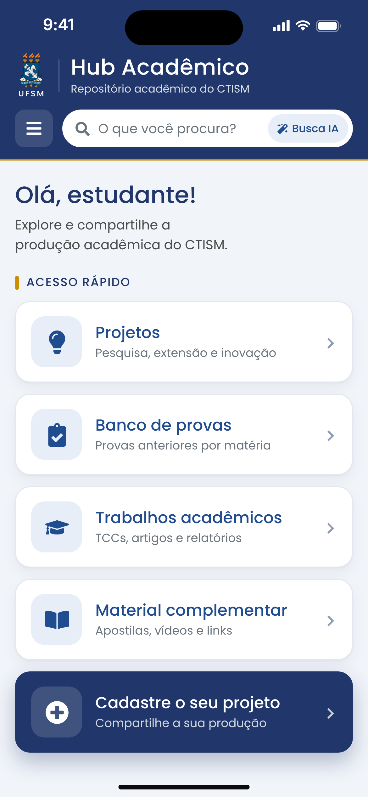
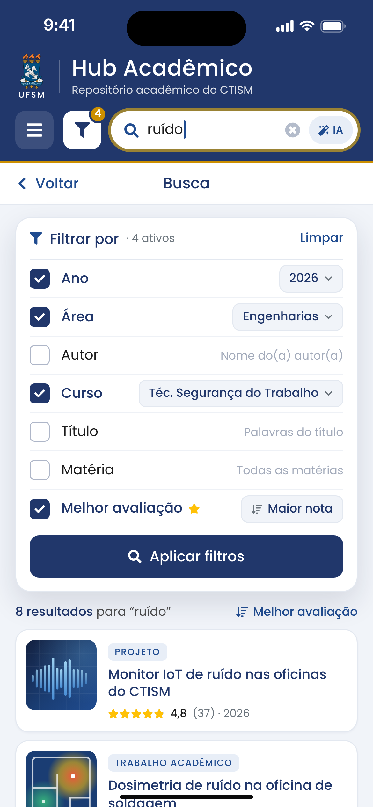
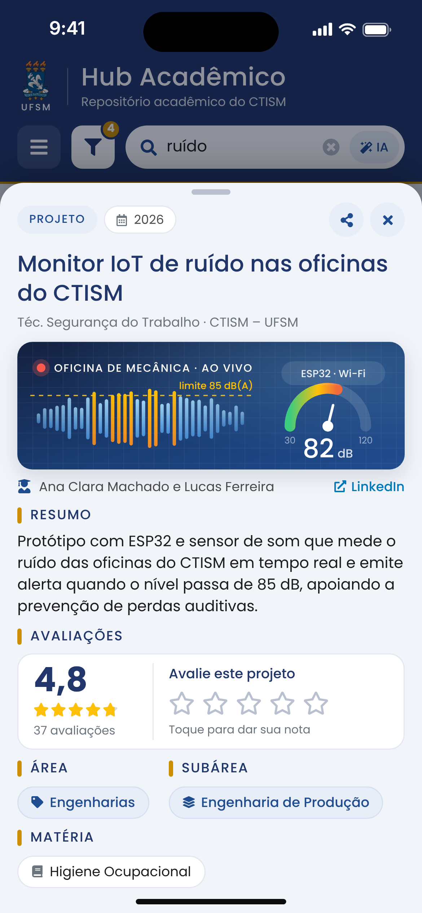
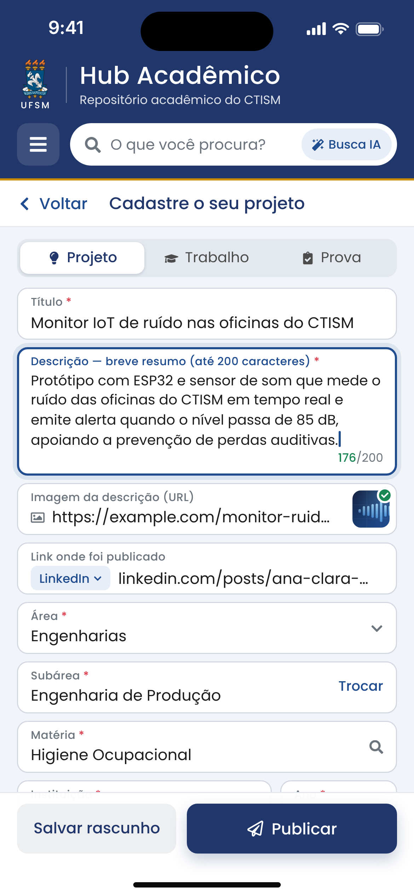
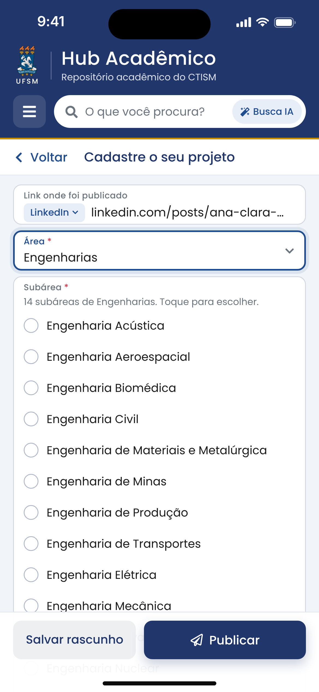

# Hub Acadêmico — Repositório acadêmico do CTISM/UFSM

Aplicativo iOS em **SwiftUI** para os(as) estudantes do Colégio Técnico Industrial de Santa Maria (CTISM/UFSM) publicarem e encontrarem **projetos**, **trabalhos acadêmicos**, **provas** (banco de provas) e **material complementar**.

Projeto desenvolvido no **HackaTruck MakerSpace** (Instituto de Pesquisas Eldorado), Deploy 26.1. O visual segue o design system do site da UFSM.

<p align="center">
  
  
  
  
</p>

> Prancha completa com o design system: [`docs/visao-geral-design-system.png`](docs/visao-geral-design-system.png)

---

## Funcionalidades

O app tem **3 telas de navegação e 1 sheet**, ou seja, **4 views programadas**: a Tela 3 (visualização) não é uma página nova, ela sobe como *sheet* por cima da busca.

| Tela | O que faz |
|---|---|
| **1. Início** | Cinco atalhos em **ordem crescente de caracteres**: Projetos → Banco de provas → Trabalhos acadêmicos → Material complementar → **Cadastre o seu projeto** (em destaque). Os quatro primeiros abrem a Busca já filtrada por aquele tipo. Mostra o primeiro nome do perfil na saudação. |
| **2. Busca** | Campo de busca no cabeçalho, sem diferenciar acentos nem maiúsculas (também procura na área, subárea e matéria). O **funil** abre os filtros em checkbox, também em ordem crescente de caracteres: Ano, Área, Autor, Curso, Título, Matéria e Melhor avaliação. O selo dourado mostra quantos filtros estão ativos. O botão **Busca IA** liga a busca por significado. Quando aberta por um atalho, mostra só aquele tipo (o selo com ✕ volta para todos). |
| **3. Visualização (sheet)** | Sobe por cima da busca ocupando **80% da altura** e pode ser arrastada até a tela cheia ou para baixo para fechar. Mostra título, imagem carregada da URL informada, autoria com link para a publicação original, resumo, **média de avaliações com estrelas para o(a) estudante avaliar**, área, subárea e matéria. Também permite compartilhar. |
| **4. Cadastro** | Um só formulário para Projeto, Trabalho ou Prova: Título, Descrição (contador de **200 caracteres**), Imagem (URL, com prévia), Link da publicação (reconhece LinkedIn, Instagram, YouTube, GitHub e blogs), **Área → Subárea → Matéria em cascata** (veja abaixo), Instituição e Ano. Valida os campos e salva rascunho; ao publicar, volta para a tela anterior e abre a nova publicação na sheet. A autoria vem do cartão **“Publicando como…”**, que abre o perfil (nome e curso). |

### Navegação

- **‹ Voltar** (seta com o texto “Voltar”), à esquerda da barra das telas internas, volta **uma tela**. O gesto de arrastar da borda esquerda continua funcionando.
- **☰** no cabeçalho volta **direto para a tela inicial**, de qualquer ponto do app (fecha também a sheet, se estiver aberta). O menu que existia nele foi retirado.

### Cadastro em cascata: área → subárea → matéria

<p align="center">
  
  
</p>

1. **Área:** as 8 grandes áreas da tabela do CNPq.
2. **Subárea:** ao escolher a área, as subáreas dela **abrem logo abaixo, dentro do próprio campo Subárea** (104 no total; as da mesma família, como “Agronomia/…” e “Medicina/…”, ficam agrupadas). Escolhida a subárea, a lista fecha e mostra só a escolhida, com **Trocar** para abrir de novo.
3. **Matéria:** abre a lista das matérias **daquela subárea**, tiradas dos currículos de 140 cursos de graduação da UFSM (7.077 matérias), com busca por nome ou código. Também mostra as matérias já usadas no Hub naquela subárea. Na busca aparecem ainda as de **outras subáreas** (escolher uma delas ajusta a área e a subárea) e a opção **Usar “texto digitado”**, para matérias que não estão na lista, como as dos cursos técnicos do CTISM.

Trocar a área limpa a subárea e a matéria; trocar a subárea limpa a matéria. A API do Node-RED confere se a subárea pertence à área.

**Como as matérias foram ligadas às subáreas:** pelo **assunto** de cada disciplina (nome e departamento). Ex.: *Genética Molecular e de Microrganismos* → Genética, mesmo sendo dada nos cursos de Agronomia e de Medicina Veterinária. As disciplinas sem assunto próprio (TCC, estágio, tópicos especiais) ficam na subárea do curso. A classificação completa, para conferência, está em [`docs/materias-por-subarea.csv`](docs/materias-por-subarea.csv) (abre no Excel). Duas subáreas não têm disciplina correspondente nos currículos da UFSM: *Educação/Orientação e Aconselhamento* e *Engenharia Naval e Oceânica*; nelas, a matéria é digitada.

O app funciona **sozinho no aparelho** (modo demonstração) ou **ligado ao Node-RED**, que guarda as publicações, as cadeiras (matérias), os usuários e as avaliações de toda a turma. Veja [Banco de dados no Node-RED](#banco-de-dados-no-node-red).

O app já vem com **12 publicações fictícias** de exemplo e com os **17 cursos oficiais do CTISM**.

### Busca IA (no próprio aparelho)

A Busca IA compara o **significado** da pergunta com o de cada publicação. Ela usa os *embeddings* em português do framework **NaturalLanguage** da Apple, que rodam no iPhone: não precisa de internet nem de chave de API, e nenhum dado sai do aparelho. Se o aparelho não tiver o modelo de frases, o app usa a média dos vetores das palavras. Se também não houver esse modelo, a busca continua só por palavras e um aviso aparece na tela.

---

## Requisitos

- Mac com **Xcode 16 ou mais recente**
- **iOS 17** ou mais recente (Simulador ou iPhone)
- Nenhuma dependência externa: só SwiftUI, Observation, NaturalLanguage e CoreText
- Opcional: **Node-RED** (qualquer versão recente) para compartilhar os dados entre os aparelhos

## Como rodar

1. Abra `HubAcademico.xcodeproj` no Xcode.
2. Escolha um simulador de iPhone (ex.: iPhone 16) e pressione **⌘R**.
3. Para rodar no seu iPhone, escolha seu time em *Signing & Capabilities → Team*. Se o identificador `br.ufsm.ctism.hubacademico` já estiver em uso na sua conta, troque por outro (ex.: `br.ufsm.ctism.hubacademico.seunome`).

> O projeto usa **pastas sincronizadas** do Xcode 16: qualquer arquivo colocado dentro de `HubAcademico/` (código, imagens, fontes, JSON) entra no app automaticamente, sem precisar arrastar nada para o projeto.

**Se o Xcode não abrir o projeto:** crie um projeto novo (*iOS → App*, Interface **SwiftUI**, nome `HubAcademico`). Depois apague os arquivos gerados `ContentView.swift`, `HubAcademicoApp.swift` e `Assets.xcassets` e arraste para dentro dele a pasta `HubAcademico/` deste repositório. Em *Build Settings*, aponte *Info.plist File* para `Config/HubAcademico-Info.plist`.

### Ligar ao servidor Node-RED

O endereço do servidor fica nos **Ajustes do iPhone**, fora do app (o ☰ agora só volta ao Início):

- **Ajustes › Apps › Hub Acadêmico › Endereço** (no iOS 17: **Ajustes › Hub Acadêmico**).
- Ex.: `localhost:1880` no simulador, `192.168.0.10:1880` no iPhone (IP do Mac do laboratório) ou `https://seu-node-red`.
- Campo em branco: o app usa só os dados guardados no aparelho. A mudança vale quando você volta ao app.

Para a turma toda já abrir ligada ao servidor, preencha `HubServidorURL` em `Config/HubAcademico-Info.plist` antes de compilar: na primeira abertura, o endereço é copiado para os Ajustes, onde pode ser trocado. Se o endereço digitado nos Ajustes for inválido, a busca mostra um aviso e o app continua com os dados do aparelho.

> Em alguns simuladores recentes, a página do app pode não aparecer nos Ajustes. Nesse caso, use o `HubServidorURL` do Info.plist.

---

## Estrutura

```
HubAcademico/
├── App/                 Entrada do app, estrutura raiz, navegação e sheet da Tela 3 (Router)
├── DesignSystem/        Cores, tipografia, componentes, barra "‹ Voltar" e cabeçalho institucional
├── Modelos/             Producao, tipos, áreas e subáreas (CatalogoAreas), cursos do CTISM, formulário e exemplos
├── Recursos/            materias-ufsm.json: matérias dos currículos da UFSM por subárea
├── Servicos/            Armazenamento, cliente da API, catálogo de matérias, busca (palavras + IA), rascunho e servidor
├── Telas/               Início, Busca, Filtros, Visualização (sheet), Cadastro, Subáreas, Matérias e Perfil
├── Utilitarios/         Extensões (texto, URL, notas) e o gesto de voltar
├── Settings.bundle      Campo "Endereço" do servidor nos Ajustes do iPhone
└── Assets.xcassets      Ícone do app, brasão, cor de destaque e capas das publicações de exemplo
Config/HubAcademico-Info.plist   Endereço padrão do servidor e permissões de rede (ATS e rede local)
backend/node-red/                Fluxo do Node-RED (banco + API), código das funções, testes e manual
ferramentas/catalogo/            Gerador do catálogo de áreas, subáreas e matérias (Python) e os dados de origem
docs/                            Imagens do design, diagrama do banco e a planilha de matérias por subárea
```

### Arquitetura em poucas linhas

- **Estado compartilhado** com `@Observable` (iOS 17): `ProducaoStore` guarda as publicações e as notas; `BuscaModel` guarda o texto, os filtros e a IA; `Router` guarda o caminho da navegação e a sheet. Os três são injetados com `.environment(...)`.
- **Cabeçalho institucional** fixo (brasão, nome, ☰ e busca), fora da `NavigationStack`, como no site. As telas internas usam a barra branca com título e **‹ Voltar** (`barraDePagina` em `Tema.swift`).
- **Navegação:** a pilha (`Router.caminho`) só tem Busca e Cadastro. “Voltar” usa o `dismiss` da tela; o ☰ chama `Router.voltarAoInicio()`, que esvazia a pilha e fecha a sheet. A Tela 3 é uma `.sheet(item:)` controlada por `Router.detalhe`, com `presentationDetents([.fraction(0.8), .large])`.
- **Cascata do cadastro:** `FormularioCadastro.escolherArea/escolherSubarea/escolherMateria` mantêm área, subárea e matéria coerentes. As subáreas vêm de `CatalogoAreas.swift`; as matérias, de `CatalogoMaterias` (lido de `materias-ufsm.json` em segundo plano ao abrir o cadastro).
- **Dois modos de dados, mesmas telas:** sem servidor, `ProducaoStore` grava tudo em `Documents/hub-dados.json`. Com o Node-RED configurado nos Ajustes, ele busca e envia pelo `APIClient` (publicar, avaliar, cadastrar perfil) e guarda uma cópia local para abrir sem conexão. A lista é atualizada ao abrir o app, ao voltar para ele e ao puxar a busca para baixo. O rascunho do cadastro fica sempre no aparelho.

### Atualizar o catálogo de áreas e matérias

Os arquivos `CatalogoAreas.swift`, `materias-ufsm.json`, `docs/materias-por-subarea.csv` e a lista de subáreas da API são **gerados**. Para mudar a classificação de uma disciplina (ou usar uma planilha mais nova da UFSM), edite as regras ou os dados em `ferramentas/catalogo/` e rode, na raiz do repositório:

```bash
python3 ferramentas/catalogo/gerar_catalogo.py
```

O script usa só a biblioteca padrão do Python 3 e, com o Node.js instalado, também atualiza o fluxo do Node-RED.

---

## Banco de dados no Node-RED

A pasta [`backend/node-red`](backend/node-red) tem o fluxo pronto para importar, com as tabelas do rascunho (**projetos, cadeiras, users e avaliações**, agora com a coluna `subarea`) e a API REST que o app usa. Resumo:

1. Rode o Node-RED (`npm install -g --unsafe-perm node-red` e depois `node-red`).
2. No `~/.node-red/settings.js`, ative `contextStorage: { default: { module: "localfilesystem" } }` para os dados não sumirem ao reiniciar.
3. No editor (http://localhost:1880), use ☰ › **Import** › `backend/node-red/hub-academico-flows.json` e clique em **Deploy**.
4. No iPhone ou simulador: **Ajustes › Apps › Hub Acadêmico › Endereço** › `localhost:1880` (simulador) ou `IP-DO-MAC:1880` (iPhone). Volte ao app.

O passo a passo completo, o diagrama das tabelas, as rotas com exemplos em `curl`, a moderação e os testes estão em [`backend/node-red/README.md`](backend/node-red/README.md).

---

## Design system (extraído de ufsm.br)

| Token | Valor | Uso |
|---|---|---|
| Azul UFSM | `#21376B` | cabeçalho, títulos, botão primário (`--bs-primary` do site) |
| Azul secundário | `#204C90` | ícones e rótulos, como na faixa "Utilidades" do site do CTISM |
| Azul profundo | `#142140` | fundos de destaque |
| Dourado | `#CC8F00` | filete do cabeçalho, marcadores de seção |
| Âmbar | `#FFC107` | estrelas de avaliação |
| Texto | `#1C1C1C` / `#4C4C4C` / `#6C757D` | níveis 1, 2 e 3 |
| Fundo e bordas | `#F1F4F9` / `#D3D7E1` | telas e campos |
| Fonte | **Rawline** (400, 500, 600, 700) | fonte oficial do tema da UFSM |
| Raios | 10 / 14 / 16 pt | campos e botões / cartões / menu |

| Ícone no site (Font Awesome 5) | SF Symbol usado no app |
|---|---|
| `lightbulb` (Projetos) | `lightbulb.fill` |
| `clipboard-check` (Banco de provas) | `checklist` |
| `graduation-cap` (Trabalhos acadêmicos) | `graduationcap.fill` |
| `book-open` (Material complementar) | `book.fill` |
| `plus-circle` (Cadastre o seu projeto) | `plus.circle.fill` |
| `filter` / `search` / `bars` (voltar ao Início) | `line.3.horizontal.decrease` / `magnifyingglass` / `line.3.horizontal` |
| `chevron-left` + “Voltar” | `chevron.backward` + “Voltar” |
| `magic` (Busca IA) / `star` | `wand.and.stars` / `star.fill` |

### Usar a fonte Rawline (recomendado)

Sem a Rawline, o app usa a fonte do sistema e o layout continua igual. Para ficar idêntico ao site:

```bash
pip install fonttools brotli
mkdir -p HubAcademico/Recursos/Fontes && cd HubAcademico/Recursos/Fontes
for p in 400 500 600 700; do
  curl -O https://www.ufsm.br/app/themes/ufsm/fonts/Rawline/rawline-$p.woff2
  python3 -c "from fontTools.ttLib import TTFont; f = TTFont('rawline-$p.woff2'); f.flavor = None; f.save('rawline-$p.ttf')"
  rm rawline-$p.woff2
done
```

Pronto: o app registra os arquivos `.ttf` sozinho na abertura (`FontRegistry`), sem precisar mexer no Info.plist. Antes de publicar as fontes em um repositório público, confira a licença da Rawline. Se preferir não versioná-las, descomente a linha correspondente no `.gitignore`.

---

## Pontos de atenção

- **Marca UFSM:** o brasão foi incluído a partir do arquivo fornecido para o projeto. Usar a marca em um app publicado depende de autorização da UFSM/CTISM. Até lá, prefira manter o repositório **privado** ou substitua o asset `BrasaoUFSM`.
- **Banco de provas:** publique provas somente com autorização do(a) professor(a) responsável (o app mostra esse aviso no cadastro e na lista).
- **LGPD:** nomes de autores(as) são dados pessoais. Com o servidor ligado, definam consentimento, política de privacidade e quem atende pedidos de remoção (a API já tem a rota `DELETE`).
- **Rede:** o `Config/HubAcademico-Info.plist` libera `http://` para o Node-RED do laboratório. Para publicar na App Store, usem HTTPS e retirem essa exceção.
- **Catálogo de matérias:** a ligação disciplina → subárea foi feita por regras (nome e departamento) e pode ter casos discutíveis. Confiram a planilha `docs/materias-por-subarea.csv` com os(as) professores(as) e ajustem as regras do gerador quando preciso. Os currículos são da graduação da UFSM; matérias dos cursos técnicos que não estiverem lá podem ser digitadas.
- **Dados de exemplo:** nomes, notas, textos e matérias dos exemplos são fictícios. Os cursos são os da página oficial do CTISM.
- **Atribuição:** as capas ilustradas de exemplo usam ícones do [Font Awesome Free](https://fontawesome.com/license/free) (CC BY 4.0).

## Próximos passos sugeridos

1. Login com a conta da UFSM/CTISM no lugar do perfil local (hoje o servidor identifica o aparelho).
2. Moderação no próprio app: botão de denúncia e remoção das próprias publicações (a API já aceita).
3. Incluir os currículos dos cursos técnicos do CTISM no catálogo de matérias.
4. Filtro por subárea na busca (a API já aceita `?subarea=`).
5. Envio de arquivos (PDF de provas e apostilas), além dos links.
6. Testes de unidade da busca e da validação do cadastro; suporte a modo escuro e iPad.

---

## Publicar no GitHub

```bash
cd hub-academico-ios
git init
git add .
git commit -m "Hub Acadêmico: primeira versão do app (HackaTruck Deploy 26.1)"
git branch -M main
git remote add origin https://github.com/SEU-USUARIO/hub-academico-ios.git
git push -u origin main
```

Com o GitHub CLI: `gh repo create hub-academico-ios --private --source=. --push`

## Créditos

- Idealização e desenvolvimento: **Laureano Al Alam Neto** e equipe (adicione aqui os nomes do grupo)
- HackaTruck MakerSpace: Instituto de Pesquisas Eldorado
- Identidade visual baseada no site da Universidade Federal de Santa Maria (UFSM)
- Áreas e subáreas: tabela de áreas do conhecimento do CNPq; matérias: currículos dos cursos de graduação da UFSM

## Licença

Defina a licença do código (ex.: MIT) antes de tornar o repositório público. As marcas da UFSM não estão cobertas por ela.
