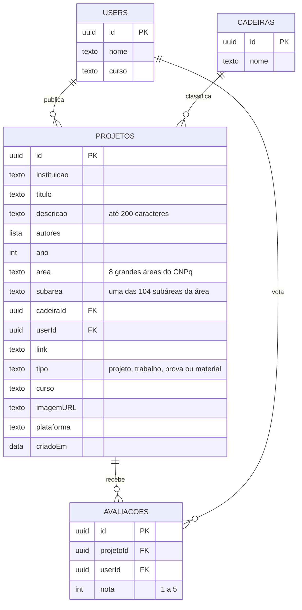

# Hub Acadêmico no Node-RED: banco de dados e API

Este fluxo transforma o Node-RED no servidor do Hub Acadêmico. Ele guarda as **4 tabelas do rascunho** (projetos, cadeiras, users e avaliações) e oferece a **API REST** que o app iOS usa para listar, publicar e avaliar.

- **Só nós do núcleo do Node-RED:** `http in`, `function`, `http response`, `inject`, `debug` e `comment`. Não é preciso instalar nada na paleta.
- **Banco no próprio Node-RED:** as tabelas ficam no contexto global, na chave `hub_db`, e são gravadas em arquivo (veja o passo 2).
- **Dados de exemplo:** na primeira implantação, o fluxo cria as mesmas 12 publicações que o app traz.
- **Áreas e subáreas:** a API confere se a subárea enviada pertence à área (tabela do CNPq, a mesma do app).

| Arquivo | O que é |
|---|---|
| `hub-academico-flows.json` | Fluxo para importar no Node-RED |
| `src/api.js` | Código do nó **API** (todas as rotas) |
| `src/seed.js` | Código do nó **Dados de exemplo** |
| `montar-fluxo.js` | Copia `src/api.js` e `src/seed.js` para dentro do fluxo depois de uma alteração |
| `testes/testar-fluxo.js` | 36 testes que rodam o fluxo sem o Node-RED instalado |

---

## Como instalar

### 1. Ter o Node-RED rodando

No Mac do laboratório, com o [Node.js LTS](https://nodejs.org) instalado:

```bash
npm install -g --unsafe-perm node-red
node-red
```

O editor abre em **http://localhost:1880**. Também funciona com Docker (`docker run -p 1880:1880 -v hub_data:/data nodered/node-red`) ou em um Node-RED na nuvem.

### 2. Fazer os dados sobreviverem a reinícios

Por padrão, o Node-RED guarda o contexto só na memória e **apaga tudo ao reiniciar**. Abra o arquivo `~/.node-red/settings.js` (no Docker, `/data/settings.js`), procure `contextStorage`, tire os comentários e deixe assim:

```js
contextStorage: {
    default: { module: "localfilesystem" }
},
```

Reinicie o Node-RED. Os dados passam a ficar em `~/.node-red/context/global/global.json`. **Copiar esse arquivo é o backup do banco.**

### 3. Importar o fluxo

1. No editor, abra o menu ☰ › **Import**.
2. Clique em **select a file to import** e escolha `hub-academico-flows.json`.
3. Clique em **Import** e depois em **Deploy**.

Vai aparecer a aba **Hub Acadêmico – API e banco**. Na barra de depuração (🐞) deve surgir a mensagem *“Banco do Hub Acadêmico criado: 12 publicações, 10 cadeiras…”*.

Para atualizar o fluxo depois, importe o arquivo novo e escolha **Replace** quando o Node-RED avisar que os nós já existem. Os dados não são apagados, porque ficam no contexto e não no fluxo.

**Vindo da versão “CTIA”:** apague a aba antiga **CTIA – API e banco** (ela respondia em `/ctia/...`) e importe este fluxo. Os dados guardados em `ctia_db` passam sozinhos para `hub_db` no primeiro Deploy. As publicações antigas ficam sem subárea (`"subarea": null`); para recriar os exemplos já com subárea, use o botão **Restaurar exemplos**.

### 4. Testar no navegador ou no Terminal

Abra **http://localhost:1880/hub/status**. A resposta deve ser parecida com:

```json
{ "ok": true, "servico": "Hub Acadêmico – Repositório acadêmico do CTISM", "totais": { "projetos": 12, "cadeiras": 10, "users": 0, "avaliacoes": 232 } }
```

### 5. Ligar o app

O endereço do servidor fica nos **Ajustes do iPhone**: **Ajustes › Apps › Hub Acadêmico › Endereço** (no iOS 17, **Ajustes › Hub Acadêmico**). Digite o endereço e volte ao app: a lista é atualizada na hora.

| Onde o app roda | Endereço |
|---|---|
| Simulador do Xcode, no mesmo Mac | `localhost:1880` |
| iPhone na mesma rede Wi-Fi | `IP-DO-MAC:1880` (veja o IP com `ipconfig getifaddr en0`) |
| Node-RED na nuvem | `https://seu-endereco` |

Sem `http://`, o app usa `http` para endereços da rede local e `https` para os demais. No iPhone, aceite o pedido de acesso à **rede local**. Se o macOS perguntar, permita conexões de entrada para o `node`.

Para que todos os aparelhos da turma já abram ligados ao servidor, preencha a chave **`HubServidorURL`** em `Config/HubAcademico-Info.plist` antes de compilar: na primeira abertura, ela é copiada para o campo dos Ajustes. Com o campo vazio nos Ajustes, o app volta a usar só os dados do aparelho.

---

## As tabelas

O rascunho foi mantido. Ganharam colunas só os campos que o app usa: tipo, subárea, curso, imagem, plataforma e data.



Versão em imagem para a apresentação: [`docs/banco-de-dados.png`](../../docs/banco-de-dados.png).

| No rascunho | No banco | Observação |
|---|---|---|
| projetos: inst, ID, titulo, desc, autor, ano, area, link | `instituicao`, `id`, `titulo`, `descricao`, `autores`, `ano`, `area`, `link` | `autores` é uma lista (trabalhos em grupo) |
| (nova) | `subarea` | nome da subárea do CNPq, sempre gravado com a grafia oficial (`GET /hub/subareas`) |
| projetos: cadeira | `cadeiraId` → **cadeiras** | a cadeira (a “matéria” do app) é criada sozinha na 1ª publicação, sem duplicar “Higiene ocupacional” e “higiene ocupacional” |
| projetos: user | `userId` → **users** | é preenchido pelo servidor e **nunca sai nas respostas** (veja Segurança) |
| projetos: avaliação | `nota` e `quant` em cada projeto | calculados a partir da tabela avaliações |
| avaliações: ID, nota, quant | uma linha **por voto**: `id`, `projetoId`, `userId`, `nota` | permite **um voto por pessoa** e trocar a nota depois; `nota` (média) e `quant` (total de votos) saem dessas linhas |
| cadeiras: ID, nome | `id`, `nome` | |
| users: ID, nome | `id`, `nome`, `curso` | o curso aparece no perfil do app |

Para ver as tabelas no editor: barra lateral › **Context Data** › **Global** › atualizar › `hub_db`.

---

## Rotas da API

Todas as respostas são JSON. Os erros vêm como `{ "erro": "…", "detalhes": ["campo: motivo"] }`.

| Método | Rota | Para quê | Precisa de |
|---|---|---|---|
| GET | `/hub/status` | Testar a conexão e ver os totais | — |
| GET | `/hub/projetos` | Listar (filtros abaixo) | — |
| GET | `/hub/projetos/:id` | Um projeto | — |
| POST | `/hub/projetos` | Publicar | `X-Hub-User` |
| DELETE | `/hub/projetos/:id` | Remover (apaga também os votos) | quem publicou ou `X-Hub-Admin` |
| POST | `/hub/avaliacoes` | Dar nota de 1 a 5; votar de novo troca a nota | `X-Hub-User` |
| GET | `/hub/subareas` | Subáreas de cada área (tabela do CNPq) | — |
| GET | `/hub/cadeiras` | Cadeiras com o total de publicações | — |
| POST | `/hub/cadeiras` | Cadastrar cadeira | `X-Hub-Admin` |
| POST | `/hub/users` | Cadastrar usuário (devolve o `id`) | — |
| GET | `/hub/perfil` | Ver o próprio usuário | `X-Hub-User` |
| PUT | `/hub/perfil` | Trocar nome e curso | `X-Hub-User` |

**Filtros de `GET /hub/projetos`:** `tipo`, `ano`, `area`, `subarea`, `curso`, `cadeira`, `autor`, `q` (texto livre, sem diferenciar acentos), `ordem=nota` e `limite` (padrão 500).

**Ao publicar:** `area` é obrigatória e `subarea` precisa ser uma das subáreas dela (sem diferenciar acentos e maiúsculas; o banco guarda a grafia oficial). A `subarea` só é opcional para não recusar versões antigas do app. A `cadeira` (matéria) aceita de 2 a 150 caracteres, porque alguns nomes de disciplinas da UFSM são longos.

Cada projeto vem assim:

```json
{
  "id": "3C657F19-D52A-5F45-AE46-BC31046D13C3",
  "tipo": "projeto",
  "titulo": "Monitor IoT de ruído nas oficinas do CTISM",
  "descricao": "Protótipo com ESP32 e sensor de som…",
  "imagemURL": "asset://capa-monitor-ruido",
  "link": "https://example.com/hub-academico/monitor-ruido",
  "plataforma": "linkedin",
  "area": "engenharias",
  "subarea": "Engenharia de Produção",
  "cadeira": "Higiene Ocupacional",
  "cadeiraId": "598191FC-98A7-52E0-BDA9-DB206348D7FA",
  "curso": "Técnico em Segurança do Trabalho",
  "instituicao": "CTISM – UFSM",
  "ano": 2026,
  "autores": ["Ana Clara Machado", "Lucas Ferreira"],
  "nota": 4.81,
  "quant": 37,
  "minhaNota": null,
  "meu": false,
  "criadoEm": "2026-11-07T16:02:00Z"
}
```

`minhaNota` e `meu` só são preenchidos quando a requisição traz o cabeçalho `X-Hub-User`. Os valores aceitos em `area` e `plataforma` são os mesmos do app (`AreaConhecimento` e `Plataforma` em `Producao.swift`); as subáreas de cada área estão em `GET /hub/subareas` e em `CatalogoAreas.swift`.

### Exemplos com curl

```bash
BASE=http://localhost:1880

# 1. Cadastrar um usuário e guardar o "id" da resposta
curl -s -X POST $BASE/hub/users -H 'Content-Type: application/json' \
  -d '{"nome":"Ana Clara Machado","curso":"Técnico em Segurança do Trabalho"}'
USUARIO=cole-aqui-o-id

# 2. Publicar
curl -s -X POST $BASE/hub/projetos -H 'Content-Type: application/json' -H "X-Hub-User: $USUARIO" \
  -d '{"tipo":"projeto","titulo":"Sensor de gás com alerta no celular",
       "descricao":"Protótipo com sensor MQ-2 e ESP32 que avisa no celular quando detecta vazamento de gás.",
       "area":"engenharias","subarea":"Engenharia Elétrica","cadeira":"Sistemas Embarcados","ano":2026,
       "curso":"Técnico em Segurança do Trabalho","autores":["Ana Clara Machado"],
       "link":"https://www.linkedin.com/posts/exemplo","plataforma":"linkedin"}'

# 3. Avaliar (troque PROJETO pelo id de um projeto)
curl -s -X POST $BASE/hub/avaliacoes -H 'Content-Type: application/json' -H "X-Hub-User: $USUARIO" \
  -d '{"projetoId":"PROJETO","nota":5}'

# 4. Listar as provas, das mais bem avaliadas para as menos
curl -s "$BASE/hub/projetos?tipo=prova&ordem=nota"

# 5. Publicações de uma subárea
curl -s "$BASE/hub/projetos?subarea=Engenharia%20de%20Produ%C3%A7%C3%A3o"
```

### Botões do fluxo (nós inject)

| Botão | O que faz |
|---|---|
| **Ao implantar: cria o banco (1ª vez)** | Roda sozinho a cada Deploy, mas só cria os exemplos se o banco nunca foi criado. |
| **Restaurar exemplos (mantém usuários)** | Apaga projetos, cadeiras e avaliações e recria os 12 exemplos. Útil antes de uma apresentação. |
| **Remover só os exemplos** | Tira as publicações de exemplo e os votos delas, mantendo o que a turma publicou. Use ao começar para valer. |

---

## Segurança e privacidade

- **Quem é quem:** não há login nesta versão. O app cadastra o perfil em `POST /hub/users` e guarda o `id` recebido, que funciona como a chave daquele aparelho no servidor. Por isso o `id` dos usuários **nunca aparece nas listas**: no lugar dele vai o campo `meu`. O passo seguinte é o login institucional da UFSM.
- **Moderação:** defina a variável de ambiente `HUB_ADMIN_TOKEN` com uma chave longa ao iniciar o Node-RED (`HUB_ADMIN_TOKEN=uma-chave-longa node-red`) e envie o mesmo valor no cabeçalho `X-Hub-Admin`. Sem a variável, a moderação fica desligada.
- **Editor protegido:** em uma rede compartilhada, ative `adminAuth` no `settings.js` para que ninguém altere o fluxo.
- **HTTPS:** o `Config/HubAcademico-Info.plist` libera `http://` (exceção do App Transport Security) para o laboratório. Em produção, use HTTPS e retire essa exceção.
- **LGPD:** o banco guarda nome, curso e as autorias informadas. Avisem os(as) estudantes sobre isso no app e combinem com a coordenação quem atende pedidos de remoção (a rota `DELETE` já existe).
- **Limites:** não há limite de requisições por aparelho. Para abrir o serviço fora do laboratório, coloquem o Node-RED atrás de um proxy com limite de taxa.

---

## Testes

Os testes leem o `hub-academico-flows.json`, conferem a estrutura (ids, ligações, uma rota para cada `case`) e executam o código dos nós `function` do mesmo jeito que o Node-RED, simulando o contexto global gravado em arquivo e as requisições HTTP:

```bash
node backend/node-red/testes/testar-fluxo.js
```

**Ao alterar o código:** edite `src/api.js` ou `src/seed.js`, rode `node backend/node-red/montar-fluxo.js` (copia o código para dentro do fluxo) e reimporte o fluxo no Node-RED. O teste avisa se o código do fluxo e o de `src/` ficarem diferentes. Uma rota nova também precisa de um nó `http in` ligado ao nó **API** (o `montar-fluxo.js` avisa quando falta).

A lista `SUBAREAS` de `src/api.js` é gerada junto com o catálogo do app (`python3 ferramentas/catalogo/gerar_catalogo.py`, na raiz do repositório); não a edite à mão.

---

## Se o curso pedir Cloudant (IBM Cloud)

O fluxo usa o contexto do Node-RED para funcionar em qualquer instalação sem pacotes extras. Para usar o IBM Cloudant, mantenha as rotas e as validações e troque só o acesso ao banco: cada tabela vira um banco do Cloudant (`projetos`, `cadeiras`, `users`, `avaliacoes`), cada linha vira um documento com `_id` igual ao `id`, e as leituras e gravações de `global.get('hub_db')` / `global.set(...)` passam a ser feitas pelos nós do Cloudant antes e depois do nó **API**. As respostas para o app continuam iguais, então o app não muda.
