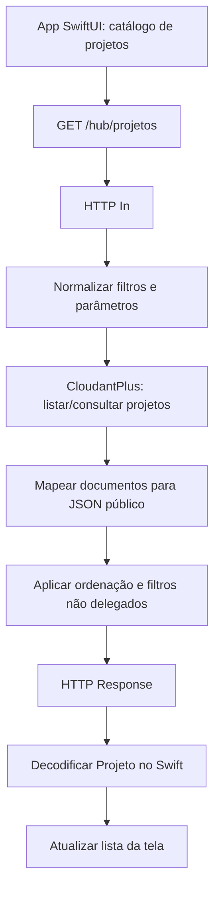
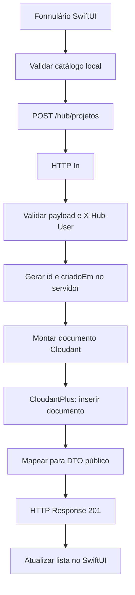

# Arquitetura Node-RED + IBM Cloudant — publicações

**Escopo aprovado para esta fase:** migrar somente a persistência das publicações que aparecem no catálogo de projetos do aplicativo: leitura por `GET /hub/projetos` e criação por `POST /hub/projetos`. O catálogo acadêmico permanece mockado no SwiftUI.

Este documento descreve a arquitetura-alvo. Não significa que a conexão Cloudant já esteja ativa nem que os dados locais tenham sido migrados.

## 1. O que fica onde

| Dado/função | Local |
|---|---|
| Áreas e subáreas | Catálogo mockado no SwiftUI |
| Cursos | Catálogo mockado no SwiftUI |
| Cadeiras/disciplinas e relações curriculares | Catálogo mockado no SwiftUI |
| Tela, filtros e seleção do catálogo | SwiftUI |
| Lista persistente de publicações | IBM Cloudant |
| Criação e validação final da publicação | Node-RED |
| Requisições REST e transformação JSON | Node-RED |
| Comunicação com o banco | Nós CloudantPlus |

Não criar `hubacademico_catalogo`, não importar CSVs de cursos/cadeiras no Cloudant e não alterar o fluxo de seleção acadêmica para consultar a rede.

## 2. Banco Cloudant

Usar um único banco: `hubacademico_projetos`.

Nesta primeira entrega, cada publicação será um documento independente:

```json
{
  "_id": "projeto:UUID",
  "tipoDocumento": "projeto",
  "id": "UUID",
  "tipo": "projeto",
  "titulo": "Sistema de monitoramento IoT",
  "descricao": "Descrição da publicação",
  "autores": ["Aluno 1", "Aluno 2"],
  "ano": 2026,
  "area": "engenharias",
  "subarea": "Engenharia Elétrica",
  "curso": "Técnico em Eletrônica",
  "cadeira": "Sistemas Embarcados",
  "instituicao": "CTISM – UFSM",
  "usuarioId": "UUID_DO_USUARIO",
  "imagemURL": null,
  "link": null,
  "plataforma": "outro",
  "criadoEm": "2026-11-11T18:00:00Z"
}
```

`area`, `subarea`, `curso` e `cadeira` são snapshots textuais da seleção feita no catálogo local. Não são chaves estrangeiras e não exigem catálogo no Cloudant. O Node-RED valida formato, obrigatoriedade, limites e tipos; a coerência entre área/curso/cadeira é validada prioritariamente no SwiftUI, pois o backend não mantém o catálogo institucional nesta arquitetura.

O campo `_id` é a chave técnica. `id` continua sendo o identificador público da API. `_rev` é controlado pelo Cloudant e nunca é enviado ao app.

### Avaliações e dados de usuário

A migração solicitada agora cobre GET e POST de projetos. As avaliações e o cadastro/perfil de usuários não devem ser migrados incidentalmente nesta mudança. Antes de ativar o novo GET, deve-se decidir como preservar os campos de resposta atuais `nota`, `quant`, `minhaNota` e `meu`: ou migrar avaliações como documentos `avaliacao:<projetoId>:<usuarioId>` no mesmo banco, ou manter temporariamente a implementação atual dessas informações até uma etapa específica. Não remover esses campos sem coordenar a mudança no app.

O cabeçalho `X-Hub-User` e o fluxo atual de identificação também precisam continuar compatíveis com o POST. A persistência definitiva de perfis/autenticação fica fora desta etapa.

## 3. Fluxo de leitura — GET



1. O app chama `GET /hub/projetos`, opcionalmente com os filtros já suportados.
2. O Node-RED consulta documentos do tipo `projeto` no banco `hubacademico_projetos`.
3. O backend converte cada documento para o DTO público, removendo `_id`, `_rev) e metadados internos.
4. A resposta mantém o formato esperado pelo app.
5. O ViewModel substitui/atualiza a coleção exibida e trata estados de carregamento, vazio e erro.

Para o primeiro corte, pode-se buscar a lista completa com limite controlado e aplicar os filtros atuais no Node-RED. Com crescimento da base, criar índices Mango para filtros mais usados e paginação por bookmark; não implementar paginação complexa antes de medir necessidade.

## 4. Fluxo de criação — POST



1. O usuário preenche o formulário usando os dados locais do catálogo.
2. O SwiftUI valida a relação entre área, curso e cadeira e envia o payload.
3. O Node-RED valida campos, limites, URLs e identificação do usuário.
4. O servidor gera `id` e `criadoEm`; o app não escolhe esses valores.
5. O Function monta o documento com `_id = "projeto:" + id`.
6. O nó CloudantPlus insere o documento.
7. Somente após confirmação da gravação, o Node-RED responde HTTP 201.
8. O app inclui o projeto retornado na lista. Em falha, mostra erro e não simula sucesso.

## 5. Organização sugerida do flow Node-RED

- **HTTP In — GET /hub/projetos**: entrada da consulta.
- **Preparar consulta GET**: sanitizar filtros, limite e ordenação.
- **CloudantPlus — consultar projetos**: buscar apenas documentos `tipoDocumento=projeto`.
- **Formatar resposta GET**: retirar metadados Cloudant e compor DTOs.
- **HTTP Response GET**: devolver JSON.

- **HTTP In — POST /hub/projetos**: entrada da publicação.
- **Validar publicação**: validar payload e `X-Hub-User`; aplicar regras já existentes.
- **Montar documento projeto**: gerar ID, data e `_id`.
- **CloudantPlus — inserir projeto**: gravar documento.
- **Formatar resposta POST**: devolver o formato público.
- **HTTP Response POST**: responder 201 ou erro apropriado.

Os dois caminhos podem compartilhar Functions utilitárias, mas não devem compartilhar um único nó Function monolítico que misture roteamento, validação e acesso ao banco. Os nós CloudantPlus são os únicos responsáveis pela operação Cloudant; não usar HTTP Request nem SDK externo.

## 6. Organização SwiftUI

Separar a origem dos dados da interface:

- `Projeto`: modelo Codable/Identifiable alinhado ao JSON público.
- `APIService`: transporte HTTP, URL, headers e codificação JSON.
- `ProjetoService`: métodos `buscarProjetos(filtros:)` e `publicarProjeto(dados:)`.
- `ProjetosViewModel`: estado de carregamento, erro, lista e atualização após publicação.
- Catálogo atual: permanece no módulo/arquivos existentes, sem conversão para API.

As telas não devem ler/escrever diretamente em UserDefaults, arquivos locais ou arrays globais como fonte definitiva das publicações. Mocks podem continuar existindo exclusivamente para Preview e testes.

## 7. Estratégia de transição sem interrupção

1. **Inventariar o armazenamento local atual**: localizar mocks, arrays, UserDefaults/arquivos e pontos de leitura/gravação; identificar se há publicações reais de teste a preservar.
2. **Congelar o contrato**: manter campos e rotas atuais, alinhar o modelo Swift e o DTO Node-RED.
3. **Preparar Cloudant**: criar `hubacademico_projetos), configurar credenciais via configuração protegida do Node-RED e testar leitura/escrita isoladamente.
4. **Implementar POST primeiro**: gravar uma publicação de teste e confirmar o documento no Cloudant.
5. **Implementar GET**: ler os documentos e devolver exatamente o formato esperado pelo app.
6. **Integrar SwiftUI**: trocar a fonte local pela API, com estados loading/empty/error e atualização somente após sucesso.
7. **Validar regressões**: cadastro, listagem, filtros, detalhes, imagens, links, identificação do autor e comportamento sem rede.
8. **Desativar persistência local**: somente após os testes; manter mocks para Preview.

Se os posts locais existentes precisarem ser preservados, fazer exportação e importação controlada antes de desligar o armazenamento antigo. Não misturar seed de demonstração com publicações reais.

## 8. Erros, segurança e operação

- `400`: payload inválido.
- `401`: usuário não identificado, conforme contrato atual.
- `409`: conflito de ID/documento, se ocorrer.
- `500`: erro inesperado.
- `503`: indisponibilidade do Cloudant, se o flow mapear explicitamente essa condição.

Guardar credenciais Cloudant nas configurações/variáveis protegidas do Node-RED, nunca no Swift nem no repositório. Usar HTTPS fora do ambiente local. Não devolver `_rev`, credenciais ou identificadores internos não previstos no contrato.

## 9. Fora do escopo desta migração

- Migrar áreas, subáreas, cursos e cadeiras para Cloudant.
- Criar API para o catálogo acadêmico.
- Refazer o formulário ou a navegação do catálogo.
- Alterar o contrato REST público sem necessidade.
- Migrar autenticação/perfis e avaliações sem decisão específica.
- Remover mocks usados em SwiftUI Previews.

## 10. Critérios de aceite

- O catálogo acadêmico continua funcionando offline e sem chamadas ao backend.
- GET lista publicações persistidas no Cloudant.
- POST grava uma publicação e só retorna sucesso após confirmação do Cloudant.
- Reabrir o app ou reiniciar o Node-RED não apaga as publicações.
- O JSON continua compatível com o modelo Swift.
- Falhas de rede/Cloudant não geram publicações fantasma na interface.
- Nenhuma credencial Cloudant é versionada no Git.
